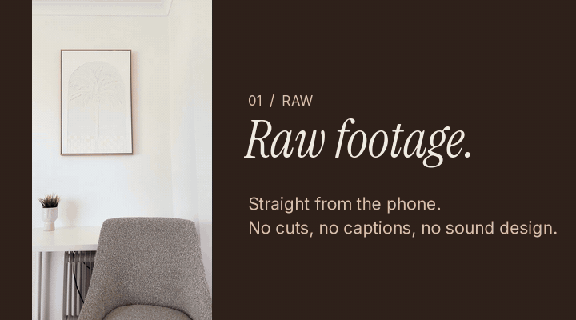
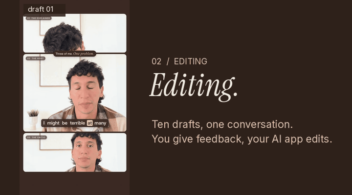
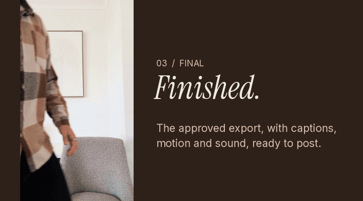
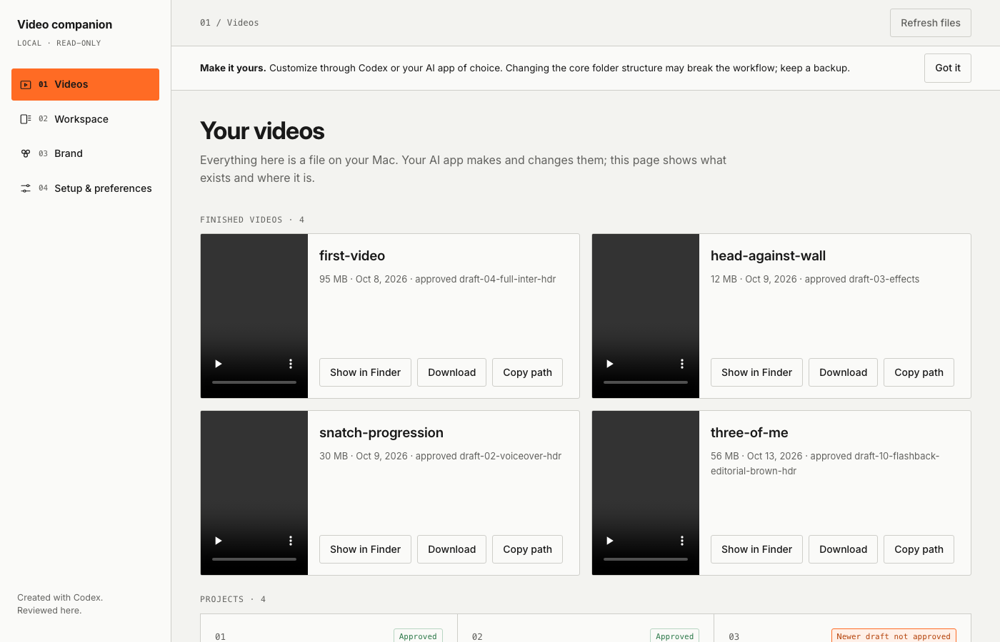

# QuickCut

**You direct. AI edits.**

Turn raw footage into professional videos by talking to your AI app — Codex, Claude Code, or your terminal assistant of choice. No timeline to learn, no clips to drag.

  

  
  
  

<em>A real QuickCut project: raw footage → ten drafts of feedback and edits → the finished video.</em>

## Get started in minutes

1. Download QuickCut from GitHub and keep the unzipped folder somewhere permanent (not inside the ZIP, not in an undownloaded cloud placeholder).
2. Open the folder as a project in your AI app — the Codex desktop app, or a terminal assistant such as Claude Code started in this folder.
3. Say "set up this video editing folder for me" and follow along. No terminal experience required.
4. Copy your footage into `workspace/drop-videos-here/` and describe the edit you want in plain language.
5. Optionally connect ElevenLabs for AI voiceovers with word-synced captions.

The full first-time walkthrough, step by step, lives in [`START HERE.txt`](START%20HERE.txt).

---

Your video is **moved** (not copied) into its own project the moment your AI app picks it up. Before it starts, your AI app writes a short plan, "this is what I have in mind", and opens it in the companion app for you to check. Approve a draft and it lands in `workspace/finished-videos/<project>/` — nothing else changes automatically.

## One brand or client per copy

A QuickCut folder is **one workspace for one brand or client**: its own style, assets and videos, with the name saved during setup. For another brand or client, copy the original folder (or tell your AI app "make a clean copy of this workspace for <name>") and set it up there. Don't mix brands in one folder.

> 📖 Here is a link to a full tutorial on how to make the most out of QuickCut, with my own personal experience and tips on video editing, and with the truths that no one tells you behind these tools: **[read it on Substack](https://miraiengineering.substack.com/p/real-world-ai-no-tutorials-no-made)**

## The philosophy

**AI shouldn't replace your creativity. It should accelerate your execution.**

Think the finished video through first — pacing, framing, transitions, captions, sound, effects, whether images sit in front of or behind other elements. Once that's in your head, hand it to QuickCut as context and let the AI app handle the clicky stuff.

QuickCut isn't a video editor where you manually move clips around. You direct the creative decisions; the AI app and its tools do the technical execution.

## Say it, don't click it

A few examples of what you'd actually type:

> "Cut the first 15 seconds into a punchy opening, add captions, and duck the music under my voice."

> "This clip feels dark and flat — can you grade it warmer, like an old camcorder?"

> "Give me a voiceover for this script in a deep, warm, cinematic voice."

## The companion app

The companion app is a **read-only window** into your projects — it never edits, renders, or uploads anything itself. Everything happens in conversation with your AI app; the app just shows you where things stand.

- **Overview:** the workspace's projects as a tree in the sidebar and a section per project with its videos: status, approved draft, finished versions, size, and Show in Finder. It tells you what is waiting for your review.
- **Project and video pages:** a project page lists its videos and finished files. A video page has its final versions, a player, every draft newest first with the approved one marked, your feedback grouped by draft, and copy-paste feedback for your AI app. You can approve a draft right there.
- **Plan page:** when you start a new video, your AI app writes its plan and opens it here (goal, format, what it will do, what it needs from you) before it starts.
- **Brand:** your colours, fonts, caption and card samples, read straight from your editing guide. To change them, tell your AI app.
- **Setup & preferences:** what's installed, how to keep QuickCut up to date, your editing style, the asset library by topic, and connecting ElevenLabs — so your API key never passes through the chat.

The app only ever does three things itself: connect ElevenLabs, **Show in Finder** (opens a Finder window on a file inside `workspace/`, changes nothing), and **Approve** (a two-click button that records the approval, copies the draft to your finished videos and makes its poster).

## Enjoying QuickCut?

QuickCut is built and maintained as an open-source project. If it helps you make something great, consider starring the repository — it helps others find it. If you build on it, a link back to the original project is appreciated.

## License

MIT — see [LICENSE](LICENSE). You're free to use, modify, and redistribute QuickCut's code; just keep the copyright and license notice. Fonts, sounds, and other third-party assets you add to `workspace/assets/` are not covered by this license — their own terms are your responsibility (see `system/assets/README.md`).
